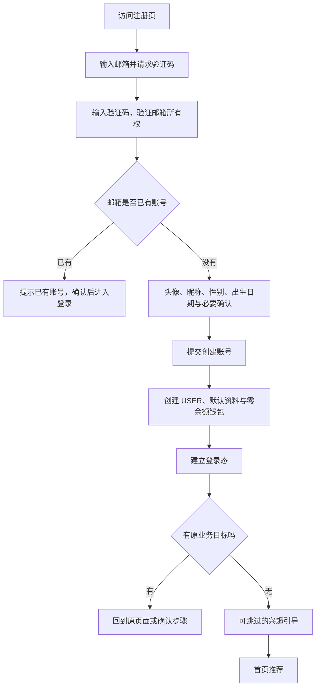

# PRD：独立注册与登录页面

版本：v1.2 开发交付基线  
日期：2026-10-09  
状态：用户已确认注册信息与紫色视觉方向，并授权继续研发、测试及上传至 `sogeryou/laeeb`。本文保留前期讨论记录；最终落地范围与待上线条件以文末交付基线为准。

## 1. 摘要

为 Le3eb Club 的游戏陪伴、组队与社区业务建立独立、可直接访问的注册和登录页面。用户先建立一个可找回的账号，再按需完善游戏资料；玩家与陪玩使用同一账号，订单、金币、钻石、等级、消息和关系记录继续绑定原 user_id。

“独立页面”已采用同一站点内的独立网址与全屏页面，不另建账号站点。需求、设计确认已完成，当前执行前后端研发、测试与用户授权的 GitHub 开发分支上传；不等同于正式生产上线。

## 2. 参与角色与决策状态

| 角色 | 责任 | 当前状态 |
| --- | --- | --- |
| 产品负责人（用户） | 确认登录方式、注册信息、年龄政策、游客权限和上线范围 | 已确认需求 |
| 产品 | 梳理流程、规则、信息字段、异常与验收标准 | v1.0 需求基线 |
| 设计 | 按确认稿输出移动端优先的页面与交互状态 | 设计评审阶段 |
| 前端／后端 | 按确认后的页面和业务契约研发 | 未开始 |
| QA | 按需求编号覆盖接口、用户路径和回归 | 未开始 |

**用户已经明确的要求：**独立注册登录页面；先产品文档，确认后出设计稿，再研发与测试。此前“登录注册先不动”的约束在本功能内被此次重做请求替代；不代表其他页面可改版，也不代表允许上传代码。

**用户最新明确要求优先于 v1.0：邮箱在前，随后填写头像、昵称、性别、出生日期，再选择标签；出生日期必须满足已满 18 周岁。新提出的头像来源、性别隐私和标签数量等规则见第 9 节，不能视为已获确认。**

## 3. 背景与现状

### 3.1 产品定位

依据项目 README，产品围绕真实的游戏社交、组队与陪伴服务，提供匹配、履约和治理能力。结合此前确定的中东市场方向，认证流程需要支持阿拉伯语、英语及移动端使用，并为社区身份、交易记录和陪玩身份提供稳定的账号基础。

产品当前是移动优先 H5，并非已经交付的原生 App。独立认证页面首先覆盖 H5；未来 App 套壳可复用业务逻辑，原生登录方式另行规划。

### 3.2 当前实现事实

| 能力 | 当前代码事实 | 对新需求的影响 |
| --- | --- | --- |
| 页面形式 | `AuthModal.tsx` 以内嵌弹窗完成认证 | 需要独立网址、刷新和返回行为 |
| 密码注册 | 昵称、邮箱、密码，密码长度 8–128；注册接口直接创建 USER | 尚未要求验证邮箱所有权 |
| 密码登录 | 邮箱＋密码 | 必须保留已有用户的登录能力 |
| 验证码登录 | 6 位邮箱验证码；未注册邮箱验证后直接自动建号 | 需要避免未经注册确认就创建正式账号 |
| 邮件发送 | 当前 `ConsoleMailSender` 只记录日志 | 不能当作真实邮件已可送达；需接入并验收邮件服务 |
| 验证码存储与限流 | 内存存储、5 分钟有效、60 秒发送间隔、最多 5 次校验；登录限流接口当前直接放行 | 生产邮件与可靠限流需要实际建设 |
| 登录态 | 已有 access／refresh 接口；用户端主要保存 access token，存在多个认证状态入口 | 需统一恢复、刷新、退出与失效处理 |
| 玩家与陪玩 | 注册默认为 USER；申请审核后获得陪玩能力 | 延续单账号，不额外注册陪玩账号 |
| 账号信息规划 | 已有 `docs/user-system-table-design.md` | 库表规划是设计输入，不代表已迁移落地 |

代码依据：`backend/routes/auth.ts`、`backend/auth/emailCode.ts`、`shared/schemas.ts`、`client/app/useAppState.ts`、`client/components/auth/AuthModal.tsx`、`client/app/AppRoot.tsx`。

## 4. 目标与评估

### 4.1 目标

1. 新用户知道如何建号，老用户知道如何登录与找回账号。
2. 在收集最少必要信息的前提下验证邮箱所有权。
3. 用户在陪玩主页、私信或下单前被引导登录后，能回到原位置。
4. 避免重复账号、重复钱包、权限越界和旧用户数据丢失。

### 4.2 指标定义

上线前建立埋点，灰度后连续观察 7 个自然日；暂无历史基线，不承诺虚构的提升比例。

| 指标 | 分子／分母或统计方式 | 用途 |
| --- | --- | --- |
| 注册完成率 | 24 小时内成功建号的去重新用户流程数／启动注册的去重新用户流程数 | 发现注册流失 |
| 邮箱验证完成率 | 验证成功的流程数／邮件服务接受发送的流程数，同一流程窗口内 | 发现收件、输入与重发问题 |
| 登录成功率 | 成功建立会话的登录流程数／提交有效格式凭据的登录流程数 | 按密码、验证码分别统计 |
| 注册用时 | 从启动注册到建号成功的耗时，统计中位数和 P90 | 评估操作负担 |
| 原意图恢复率 | 登录后成功回到原业务目标的流程数／带有效返回目标的成功登录流程数 | 保障业务连续性 |
| 错误率 | 邮件发送失败、验证码过期、限流、会话刷新失败分别统计 | 定位稳定性问题 |

同一注册流程使用短期 flow_id 去重；不得把邮箱、密码、验证码、令牌写入分析事件。指标不是身份认证凭据。

## 5. 用户场景

| 用户 | 需求 | 流程重点 |
| --- | --- | --- |
| 首次访问的玩家 | 先了解平台，再找人组队或下单 | 可浏览，不强制首屏注册 |
| 从分享或陪玩主页进入的用户 | 登录后继续联系原陪玩 | 保存原目标和页面上下文 |
| 回访玩家 | 迅速找回消息、订单与余额 | 验证码／密码登录与登录态恢复 |
| 希望成为陪玩的用户 | 使用已有账号申请服务者身份 | 注册默认玩家，申请不另建号 |
| 已有密码账号、纯验证码账号 | 原有账号继续可用 | 识别已有登录方式，数据不重置 |

## 6. 产品方案与价值

### 6.1 登录方式选择

| 方案 | 好处 | 代价 | 本稿建议 |
| --- | --- | --- | --- |
| A. 邮箱验证码优先，密码作为已有账号及可选登录方式 | 新用户无需先设置密码；兼容现有两种路径 | 依赖邮件送达；每次验证码登录有收件步骤 | 推荐第一期 |
| B. 注册验证邮箱并强制设密码，密码登录优先 | 回访用户不必每次收件 | 注册更长，必须完善找回密码 | 可选 |
| C. 手机号验证码优先 | 对习惯手机登录的用户直接 | 增加国家区号、短信供应商、送达和成本管理 | 第一阶段暂不推荐 |

以上是基于现有能力与操作步骤的产品判断，不代表已有用户研究证明邮箱方案转化更高。Google、Apple、Passkey 与手机号作为后续扩展，不在未经确认时展示不可用按钮。

### 6.2 核心原则

- 账号与用户资料分开：验证邮箱用于登录与找回，昵称与游戏偏好用于社交。
- 玩家与陪玩共享一个 user_id；陪玩是申请获得的业务身份，不是新的登录账号。
- 注册只收最少必需信息；第一次下单、陪玩申请与提现各自在对应场景收集所需资料。
- 公开主页不展示登录邮箱、年龄声明、设备标识和安全记录。
- 登录完成只恢复页面或草稿，不自动扣款、发消息、发动态、接单或申请陪玩。

## 7. 需求与业务规则

### 7.1 页面范围（AUTH-01）

建议同站点设置：

| 页面 | 建议地址 | 核心内容 |
| --- | --- | --- |
| 登录 | `/login` | 邮箱验证码登录为默认、密码切换、去注册、找回密码、语言选择、返回浏览 |
| 注册 | `/register` | 邮箱输入、验证、账号资料与必要确认 |
| 完善账号 | `/register/profile` | 经邮箱验证后填写头像、昵称、性别、出生日期并确认协议，最终创建账号 |
| 标签选择 | `/onboarding` | 游戏偏好、相处风格及生活兴趣；数量与跳过规则见第 9 节 |
| 找回密码 | `/forgot-password` | 发起找回、验证邮箱、新密码设置 |
| 设置新密码 | `/reset-password` | 持短期重置凭据设置密码，不接受邮箱参数直接修改 |
| 账号受限 | `/account-restricted` | 按既有账号政策说明限制并提供客服入口 |

验证码步骤可属于对应页面内部状态，不要求每一步都是新网址。独立页面不出现业务底部导航；保留产品标识、语言、返回入口和协议入口。移动端优先，桌面布局在设计阶段确定。管理员继续从 `/admin` 独立入口登录，不开放注册管理员角色。

### 7.2 注册主流程（AUTH-02）

1. 邮箱去除首尾空格，沿用当前小写匹配策略；不擅自删除邮箱中的点、加号后缀或合并不同地址。
2. 请求验证码前不创建正式用户、不建立业务登录态、不占用正式昵称、不写入钱包。
3. 验证通过后，服务端签发仅能完成对应邮箱注册的短期凭据；建议有效 15 分钟。前端传入 `emailVerified=true` 不构成证明。
4. 资料页显示已验证邮箱；修改邮箱即作废验证状态，重新验证。
5. 最终提交头像、昵称、性别、出生日期与协议版本，校验已满 18 周岁后才创建正式账号。中途退出仅保留可过期的流程状态；生日不是强实名验证。
6. 创建账号、用户资料、协议记录与钱包初始化应整体成功或整体失败；同邮箱并发提交只生成一个 user_id，不产生重复钱包。
7. 建号成功自动登录；会话建立暂时失败时，提示账号已创建并进入登录重试，不再次建号。
8. 注册时邮箱已存在，只有在证明邮箱所有权后才明确提示，并引导登录原账号；不覆盖旧密码、昵称、身份、余额和记录。
9. 第一阶段不强制设置密码。用户可在安全设置中完成邮箱验证后设置密码。

### 7.3 需要哪些用户信息（AUTH-03）

| 信息 | 注册是否必需 | 收集时机／默认值 | 用途及可见性 |
| --- | --- | --- | --- |
| 邮箱 | 必需 | 注册第一步；验证所有权 | 登录、找回、安全通知；仅本人和授权后台可见 |
| 邮箱验证码 | 必需验证动作 | 6 位短期凭据 | 不进入用户资料、不明文长期保存 |
| 昵称 | 必需 | 邮箱验证后，2–32 个用户可见字符 | 社区和私信展示；允许重名，用 UID 区分 |
| 服务条款接受记录 | 必需 | 最终创建前主动操作，默认未选 | 记录版本、接受时间；无同意不建号 |
| 隐私告知记录 | 必需 | 与协议说明清晰展示并记录版本 | 记录用户已看到并确认必要告知；营销授权单独处理 |
| 出生日期 | 必填；用户本轮明确要求 | 邮箱验证后的资料步骤；仅允许已满 18 周岁的日期 | 准入校验；完整生日默认不公开；不是实名年龄证明 |
| 头像 | 资料步骤必填；来源已确认 | 用户上传或选择系统头像，二选一 | 社区展示；用户上传沿用内容审核，不默认取邮箱头像 |
| 性别 | 资料步骤填写；选项待确认 | 建议男、女、不愿透露；不默认推断 | 社交资料；公开范围建议由用户控制 |
| 界面语言 | 系统默认，可修改 | 浏览器可支持语言；无法匹配则英语 | 页面和邮件语言；阿语页面支持 RTL |
| 国家／地区 | 可选 | 注册后由用户选择，不用语言推断真实国籍 | 匹配与业务地区适配；支付／提现资料按对应场景确认 |
| 游戏／兴趣标签 | 后续标签步骤 | 建议游戏、相处风格、生活兴趣三类；数量与跳过见第 9 节 | 冷启动与破冰，不决定账号权限 |
| 游戏平台、服务器、段位、游戏 ID | 非注册必需 | 找队友、游戏卡片或服务申请场景 | 针对游戏匹配使用 |
| 常用交流语言 | 可选 | 兴趣引导 | 和界面语言分开，用于交流匹配 |
| 密码 | A 方案非必需 | 原用户继续使用；新用户可后续设置 | 不公开、不明文保存 |
| 手机号、真实姓名、证件、提现账户 | 注册不收集 | 后续确有需求的认证／提现流程 | 不与普通注册混在一起 |
| 营销邮件订阅 | 非必需 | 独立可选，默认不订阅 | 拒绝不影响注册和必要账号邮件 |
| user_id、公开 UID、注册时间、账号状态 | 系统生成 | 创建成功时 | user_id 不可由前端指定；UID 用于公开区分 |
| 设备标识、必要请求来源、安全审计 | 系统按需记录 | 登录／注册安全场景 | 不要求用户手填；不可进入公开资料或一般埋点 |

昵称支持阿拉伯文、拉丁文等 Unicode 字符，去首尾空白、拒绝空白名和控制字符；字符长度在前后端按同一口径计算。内容不通过时在资料页给出可修改提示。昵称不作为唯一登录凭据。

年龄规则是本稿的产品建议，不是对任何国家法律年龄要求的结论。若允许未成年人，必须先单独定义其社交、支付、陪玩与监护规则，再调整此处；不能仅把提示改成更低年龄。

### 7.4 登录与找回（AUTH-04）

**验证码登录：**邮箱 → 发码 → 验证 → 已有账号建立会话 → 恢复原目标或进入首页。若验证码正确但邮箱没有账号，进入已验证的注册资料步骤，明确显示“完成注册”；用户确认资料与协议前不自动建号。该转换由服务端签发注册凭据，不能让登录验证码直接提交注册接口。

**密码登录：**邮箱＋密码 → 验证 → 建立会话。错误时使用统一提示，不在邮箱所有权未验证前暴露“账号不存在”“没有设置密码”等信息。界面始终提供验证码入口。旧密码满足原规则但短于新的设置要求时仍可验证登录，不强制把已有用户锁在门外。

**设置／找回密码：**申请邮件 → 验证或重置链接 → 设置新密码并确认 → 作废重置凭据和旧会话 → 返回普通登录。纯验证码账号完成验证后可设置第一份密码；不可根据邮箱字符串直接覆盖账号凭据。没有邮箱访问权时提供客服渠道，不用昵称或公开资料作为找回证明。

新设／重置密码建议 15–128 字符，允许粘贴、密码管理器、Unicode 和空格，不强制大小写／数字／符号拼装；过滤常见和泄露密码，不截断输入。该新设置规则不回写旧密码。长度、错误提示和恢复流程参考 [OWASP Authentication](https://cheatsheetseries.owasp.org/cheatsheets/Authentication_Cheat_Sheet.html) 与 [OWASP Forgot Password](https://cheatsheetseries.owasp.org/cheatsheets/Forgot_Password_Cheat_Sheet.html)；具体阈值是本项目建议，不是注册已经启用的配置。

### 7.5 验证码、失败与重试（AUTH-05）

| 场景 | 用户看到／可以做 | 服务端要求 |
| --- | --- | --- |
| 正常发送 | 邮箱脱敏显示、验证码输入、修改邮箱、重发倒计时 | 建议 6 位、5 分钟有效、60 秒重发间隔 |
| 未收到 | 检查地址、查看垃圾箱提示、倒计时后重发 | 真正发信并处理供应商失败；日志不能冒充发送 |
| 错误或过期 | 统一提示重新输入或重发，不清空邮箱 | 每个验证码最多 5 次失败，耗尽后失效 |
| 重发 | 明确“请使用最新验证码” | 新码发送成功后才替换旧码；供应商拒收不假报成功 |
| 多标签验证／重复点击 | 只有一次有效完成，其他可恢复到已完成状态 | 原子消费验证码及流程凭据，避免双重建号 |
| 网络超时 | 保留非敏感输入，允许重试 | 创建、验证和建会话的重试不得重复建号、奖励或钱包 |
| 修改邮箱 | 返回邮箱输入，提示需要重新验证 | 旧流程不能验证新邮箱 |
| 过度发码 | 显示可重试时间 | 建议单邮箱跨用途合计 5 次／小时、10 次／日；设备及来源附加限制由研发评审落实 |
| 连续登录失败 | 提示稍后重试，允许查看帮助 | 建议同账号 15 分钟内 10 次失败，暂停该认证方式 15 分钟；不同接口共享限流口径 |

注册、登录、找回、敏感操作验证必须按用途隔离；切换用途须由服务端重新授权，不接受任意跨用途复用。所有时限和次数以服务端为准，刷新页面不能清零。发码额度与失败计数需在服务重启和多实例下仍可靠；不能只靠页面倒计时或本地内存。

发码限制是建议的首版参数，灰度可调整。图形验证只在明确异常或供应商要求时触发；第三方风控后续接入按既有决策处理，当前不假定供应商已可用。

### 7.6 游客、回跳与登录态（AUTH-06）

- 建议继续允许游客浏览首页、游戏分类、陪玩公开主页及审核通过的社区内容。
- 私信发送、发布／评论、下单、充值、查看个人订单／钱包、陪玩申请等需要登录；游客触发后进入独立登录页。
- 记录受控的站内返回目标、陪玩／内容标识及可恢复草稿；不在 URL 放密码、验证码、令牌或完整私信草稿。不接受外域或后台地址作为用户认证回跳。
- 登录后回到原页面：下单回到订单确认，私信回到对话并保留草稿。账号登录不构成自动执行业务动作的授权。
- 没有原目标：登录回首页；注册先显示可跳过兴趣引导，再回首页。原目标失效时提示并回到对应上一级或首页。
- 已登录用户访问登录页，正常用户直接回合法目标；账号资料尚未完成者继续完善资料，不重新创建账号。
- 建议保留登录最长 30 天，access 凭据短时有效并自动刷新；用户主动退出、重置密码、账号处置可使会话提前失效。具体存储和防护方案由后端研发设计，不沿用“拿到 access token 就永久可用”的假设。
- 刷新失败后返回登录并保留安全的页面目标。暂停自动重发交易请求，避免重新登录后重复扣款或发单。
- 退出后清除当前设备会话与私信／钱包等个人缓存；可控的“退出所有设备”放到账号安全页。
- FROZEN、RISK_HOLD 及模块封禁沿用业务限制。证明身份后可以说明限制和帮助渠道，但不能因登录成功恢复下单、支付或其他被封能力。

### 7.7 账号、身份与数据保留（AUTH-07）

1. 一个邮箱绑定一个账号；同一账号可作为玩家使用并申请陪玩。前端不能在注册时提交 PLAYER／ADMIN 获得权限。
2. 新注册默认 USER，钱包逻辑初始值为 0，不赠送金币、钻石、等级分或优惠券，除非另有已批准活动。
3. 账号创建时保证金币与钻石账户可正确读取；允许底层按现有方式幂等初始化，不能每次登录重建或重置余额。
4. 已有 user_id、陪玩关联、历史订单、余额／冻结余额、消息、等级、动态与关系数据原样保留。不以“新注册流程”为由重建历史账号。
5. 已有密码用户继续能登录；尚未验证邮箱的旧账号可先完成原凭据登录，账号安全设置提示验证邮箱，不能误标为已验证。
6. 已有验证码账号没有密码时仍可验证码登录；不生成默认密码，不擅自从邮箱前缀生成公开实名。
7. 旧账号缺少新协议或年龄资格记录时进入补充确认状态；保留其数据。拒绝或不符合新准入建议的用户保留客服与既有余额处理渠道，不能自动清零、删除或继续购买。
8. 登录事件在身份验证和会话成功后记录；验证码发送／校验失败／注册中断不产生活动积分。陪玩登录任务继续按既有平台自然日去重。
9. 更换绑定邮箱、删除账号与被盗申诉不在本期新增功能内；保留联系客服入口，不用新流程自动合并、删除或迁移账号。

### 7.8 数据需求与接口责任（AUTH-08）

以下为拟议业务契约，不是已经存在的接口承诺；研发阶段与现有认证模块对齐。

| 业务动作 | 输入／凭据 | 输出或原子结果 |
| --- | --- | --- |
| 请求验证码 | 邮箱、用途、语言、必要防滥用信息 | challenge_id、有效时间、重发时间；不泄露注册状态 |
| 校验邮箱 | challenge_id、验证码、流程上下文 | 登录会话，或只允许完成注册的短期凭据，或重置凭据 |
| 完成注册 | 注册凭据、昵称、协议／年龄确认、幂等标识 | 一个用户、资料、必要确认记录、钱包可用；会话结果可恢复 |
| 密码登录 | 邮箱、密码、必要防滥用信息 | 当前用户及会话，不接受客户端角色 |
| 重置密码 | 重置凭据、新密码、幂等标识 | 更新凭据、失效旧会话、通知与审计 |
| 刷新／退出 | 设备会话凭据 | 刷新轮换或吊销；旧凭据不可继续刷新 |

资料存储至少区分：账号、认证身份、公开资料、用户业务身份、会话、协议／年龄记录、短期验证状态。复用库表规划中的逻辑边界，数据库迁移与邮件服务选型在研发方案中确定。新协议／年龄记录不要求立刻重构全站存储。

### 7.9 验收标准（AUTH-09）

| 验收编号 | 关联需求 | 可观察结果 |
| --- | --- | --- |
| AC-01 | AUTH-01 | 独立页面地址可直接打开、刷新与前进后退；不依赖先打开业务首页弹窗 |
| AC-02 | AUTH-02 | 邮箱未经验证、注册凭据过期或必要确认缺失时，不能创建正式账号或钱包 |
| AC-03 | AUTH-02/07 | 同邮箱重复或并发提交，最多一个 user_id；旧账号数据未改变 |
| AC-04 | AUTH-02/04 | 未注册邮箱在登录页验证成功后只进入注册资料步骤，不偷偷建号 |
| AC-05 | AUTH-03/10 | 注册资料包含头像、昵称、性别和生日；不强制手机号、证件、地区或游戏段位；昵称不会暴露邮箱 |
| AC-06 | AUTH-04 | 旧密码账号、纯验证码账号均能登录；密码找回只能由有效短期凭据完成 |
| AC-07 | AUTH-05 | 错码、过期、重发、多标签、刷新页面均不能绕过次数与用途限制 |
| AC-08 | AUTH-05 | 邮件供应商失败不会显示已成功发送；收件、验证码与日志无敏感泄露 |
| AC-09 | AUTH-06 | 从陪玩主页私信／下单触发登录，成功后回到正确对象与确认步骤，未自动发送或支付 |
| AC-10 | AUTH-06 | 直接访问认证页、取消认证、目标失效、外域回跳均有确定结果；不会进入后台 |
| AC-11 | AUTH-06/07 | 页面刷新能恢复有效会话；到期刷新正常；退出／重置后旧会话按规则失效 |
| AC-12 | AUTH-07 | 钱包余额、订单、等级、消息和陪玩身份在重做前后对照一致 |
| AC-13 | AUTH-03/07 | 注册不能自选管理员／陪玩权限；受限用户登录不能解除业务封禁 |
| AC-14 | AUTH-01/03 | 阿语 RTL、英语、移动键盘、验证码粘贴、可读错误、加载与禁用状态可操作 |
| AC-15 | AUTH-07 | 未成功登录不增加陪玩任务分；同日重复登录奖励仍按既有规则去重 |
| AC-16 | AUTH-03/07 | 未勾选必要确认不建号；旧用户拒绝补充确认不丢记录，帮助渠道可用 |
| AC-17 | AUTH-04 | 新密码、确认密码和弱密码校验一致；重置凭据只能使用一次，完成后回登录 |

研发后必须覆盖前后端测试、真实邮件收件、双账号隔离、旧用户迁移回归、移动端与阿语完整路径。此处只定义验收内容，没有声称这些测试已经通过。

## 8. 交付顺序、范围与待确认决策

### 8.1 第一阶段建议范围

独立页面、邮箱验证码注册、验证码／密码登录、可跳过兴趣引导、密码设置与找回、登录态与安全回跳、旧用户保留、真实邮件接入、必要协议与年龄记录、基础防滥用、阿语与英语路径、完整验收。

建议本期不加入手机号、Google／Apple、Passkey、自动账号合并、后台认证改版、注册奖励或完整陪玩资质认证。这些均可后续单独评审。

### 8.2 交付门槛

| 阶段 | 交付物 | 进入下一阶段的条件 |
| --- | --- | --- |
| 1. 产品确认 | 本 PRD、决策表 | 用户确认登录方式、字段与流程 |
| 2. 设计 | 登录、注册、验证、完善资料、兴趣引导、找回与异常状态稿；移动端／桌面与 RTL | 用户确认设计稿 |
| 3. 研发准备 | 页面／接口契约、数据与迁移方案、任务拆分、测试案例 | 与确认稿逐项对应；邮件服务与环境具备验收条件 |
| 4. 前后端研发 | 本地可操作的功能与自动化测试 | 核心路径与旧数据回归通过 |
| 5. 测试验收 | 验收记录、问题清单、已知限制、预览 | 用户验收确认；未解决阻断问题不能进入发布 |
| 6. 上传／发布 | 用户批准的代码提交与发布版本 | 另行获得上传／发布指令 |

第 1 阶段需求已确认，当前进入第 2 阶段设计评审。工期在设计确认后估算，不预先承诺日期。

### 8.3 已确认的产品决策

| 决策 | 本稿建议 | 影响 |
| --- | --- | --- |
| D-01 登录与注册方式 | A：邮箱验证码优先；密码兼容并可后续设置；第一期不接手机号／第三方登录 | 页面、邮件成本、密码找回范围 |
| D-02 注册信息 | 本轮由用户调整为邮箱验证→头像、昵称、性别、出生日期→标签；国家、交流语言等不强加注册必填 | 注册步骤与资料完整度 |
| D-03 年龄准入 | 仅 18+，本轮改为出生日期校验；身份／提现按独立场景处理 | 未成年人范围及旧用户补充确认策略 |
| D-04 身份模型 | 默认玩家；同账号申请陪玩；不另建陪玩账号 | 与现有订单、钱包、等级一致 |
| D-05 游客与注册后去向 | 游客可浏览；有原目标则恢复，无目标则可跳过兴趣引导后到首页 | 首页体验与转化路径 |
| D-06 页面独立方式 | 同站点独立网址／全屏页面；共用现有账号体系 | 不需要另起域名和跨站登录 |

确认依据：产品负责人在本稿交付后于 2026-10-08 回复“确认”。D-01 至 D-06 采用推荐方案并锁定 v1.0；本次确认不代表设计稿已确认，也不授权提前进入研发或上传。

## 9. v1.1：用户明确调整与补充建议

### 9.1 本轮已明确（AUTH-10）

注册顺序：输入邮箱 → 验证邮箱（沿用既有规则）→ 填写头像、昵称、性别、出生日期 → 确认必要协议并创建账号 → 选择标签 → 首页／原业务目标。

“可选日期距离今日不得小于 18 岁”指日期选择器的可选范围，不表示生日字段选填。生日必填且初始为空，不能默认替用户填成 18 岁。

- 判断为出生年月日不晚于“平台今日减 18 年”的有效日期，而非 18×365 天；生日当天可通过。
- 2026-10-08 的最大可选日期为 2008-10-08；2008-10-09 必须拒绝。具体今日取服务端平台业务日期，不信任用户设备时间。
- 选择器禁用不满 18 岁的日期；手动输入、接口提交、修改设备日期仍须由服务端拦截。
- 闰日建议规则：在非闰年，2 月 29 日出生者于 3 月 1 日达到对应周岁。平台业务时区与闰日口径须在研发方案中明示；这是产品规则建议，不是法律结论。
- 完整生日作为私密资料，不能进入公开接口、埋点或 URL；不得只隐藏前端却由接口泄露。是否公开年龄属于独立可见性设置。
- 旧用户缺少生日不得直接删号、重置余额或强制重新注册；按补充资料流程收集，保留帮助与余额处理渠道。

### 9.2 头像与性别（AUTH-11，部分待确认）

- 头像必须完成选择；用户于本轮回复“都允许”，已确认用户上传与系统头像均可，二选一，不强制露出真人面孔。
- 上传建议支持 JPG、PNG、WebP，建议最大 10MB；选择后裁切预览，支持返回替换；具体值待确认。生产服务须检查真实类型、去除 EXIF 等定位信息、限制解码尺寸、进入内容审核；拒绝后允许修改，不能让审核失败清空其他资料。
- 系统头像应为合法自有资产，不能默认随机使用陌生真人照片，不能把生成氛围图中的人物当成平台用户。
- 性别建议 Woman／Man／Rather not say，不默认选中；不强制推断，公开范围可在设置中控制。以后若扩充选项，应同时更新后端枚举及筛选，不仅改前端。

### 9.3 标签与额外信息（AUTH-12，建议待确认）

建议分为游戏偏好、相处风格、生活兴趣。不要把“找朋友、打排位、想聊天”当成性取向或约会目标，也不要求政治、宗教、收入等敏感标签。

本稿建议：推荐选 3 个，最多 5 个，允许暂时跳过；延续低负担引导，而非强制填满。标签使用后台稳定 ID、可本地化名称与上下架状态，不把用户输入文本直接用于身份或风控。选择数量、必选类别和是否允许跳过最终待用户确认。

可补充但不增加必填步骤：交流语言（便于跨语言陪伴匹配）、国家／地区（用户自选，不要求精确位置）、一句话介绍／破冰问题（可选，主页后补）。不在注册时请求联系人、相册全量读取、定位或通知权限；需要时再申请。营销订阅继续独立自愿。

建号成功后再保存标签：标签保存失败保留账号与选中内容，可重试或稍后完成，不能再次建号／钱包初始化。有原目标可先回原目标，不强制打断交易意图。

### 9.4 新增验收

| 编号 | 可观察结果 |
| --- | --- |
| AC-18 | 未填写有效生日、头像选择或昵称等必要资料不能创建正式账号；未选择性别不自动默认 |
| AC-19 | 满 18 岁当天通过，差一天拒绝；手动输入或更改设备时间不能绕过服务端年龄校验 |
| AC-20 | 闰日、无效日期、时区跨日均按明确规则处理，不用近似天数计算年龄 |
| AC-21 | 公开资料与网络接口中没有完整出生日期、登录邮箱或头像原始定位信息 |
| AC-22 | 头像失败可替换且保留其他资料；系统头像方案按最终确认执行 |
| AC-23 | 标签可回退编辑、达到上限有明确提示；失败不重复建号，跳过按最终确认执行 |
| AC-24 | 旧用户补充资料仍使用原 user_id，历史余额、订单、等级与消息不改变 |

### 9.5 设计方向变更

用户明确认为 v0.1 排版杂乱、过于生硬、AI 模板感重；要求青春、有社交吸引力。v0.2 曾提案暖白／珊瑚色，现按最新要求由 v0.3 替代：恢复与端内一致的深紫背景和紫色主按钮，保留简洁布局，减少营销和重复说明，用图标步骤、短文案与轻转场承接注册流程。字段标签、18+／生日隐私、协议和错误恢复信息不省略。系统开启减少动态效果时不播放位移动画。用户随后已授权按此方向研发，不延伸改版到首页、陪玩中心或后台。

## 10. 2026-10-09 最终开发基线

前文“待确认”“未开始”属于历史提案阶段记录，以下为当前交付范围：

- 邮箱验证码在前；头像必填但允许系统头像或上传，不要求真人照；昵称 2–32 个可见 Unicode 字符、允许不唯一；性别为女／男／不愿透露，不默认选择；出生日期必填并由服务端校验 18+。
- 标签推荐 3 个、最多 5 个、允许跳过；新用户默认 USER，后续另行申请陪玩。已有邮箱经过验证码验证后登录原账号，不重复建号；旧账号原密码保留。
- 当前网址采用 `/auth/login`、`/auth/register`、`/auth/verify`、`/auth/profile`、`/auth/interests`、`/auth/forgot-password`、`/auth/reset-password`、`/auth/restricted`，替代前文建议路径。
- 普通用户使用独立页面，管理员保留 `/admin`；登录后恢复安全的原业务目标，不自动发消息、支付或下单。
- 已完成前后端开发与本地测试，用户授权上传 `sogeryou/laeeb` 的开发分支，不覆盖 main，不代表生产部署。真实邮件送达、正式协议、生产存储与内容风控等条件见 `docs/auth-independent-local-acceptance.md`。
